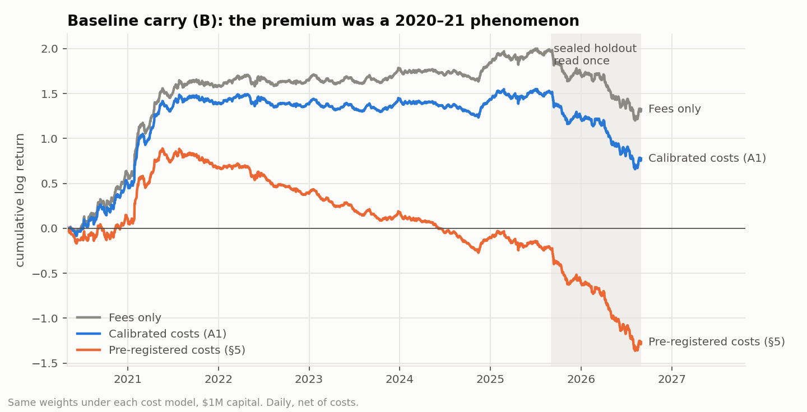
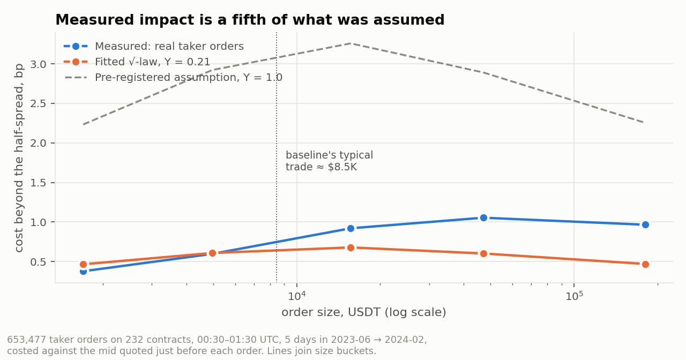
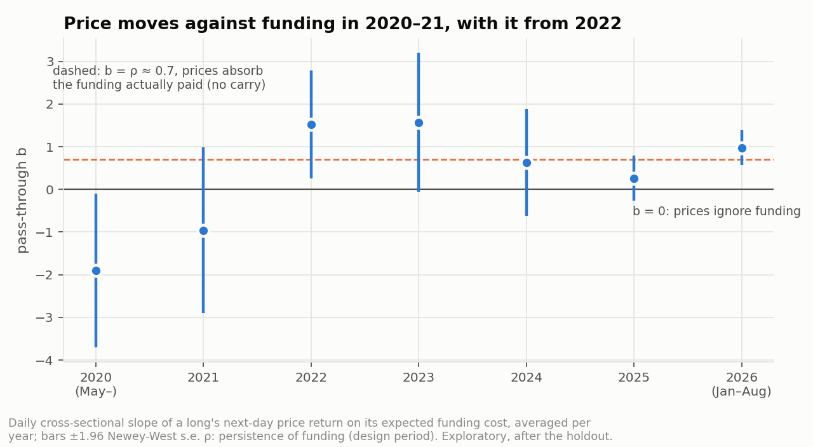
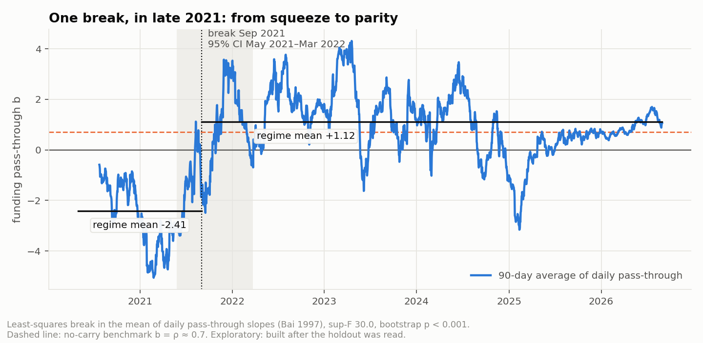
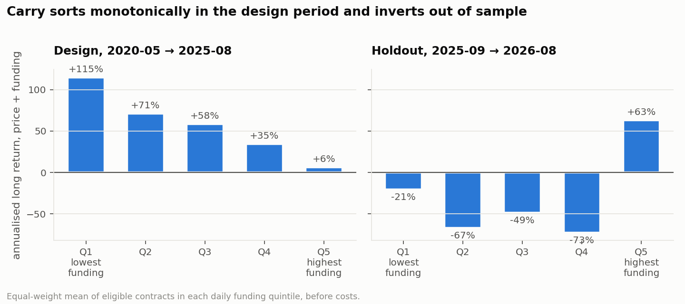
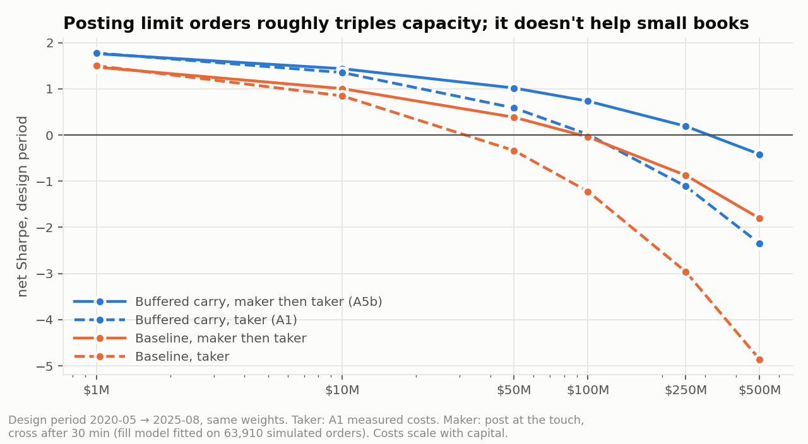

# Results

Every number below comes from a file the pipeline writes: `results/design/summary.json`,
`results/holdout/summary.json`, `results/design/costs.json`, `results/diagnostics.json` and
`results/hyperliquid/*.json`. The specification, every amendment and when each was written are in
[PREREGISTRATION.md](PREREGISTRATION.md); the reason for each design choice is in [DECISIONS.md](DECISIONS.md).

| Period | Dates | Status |
|---|---|---|
| Design | 2020-05-01 → 2025-08-30 (1,948 days; first day with 20 eligible contracts) | used to build and calibrate everything |
| Holdout | 2025-09-01 → 2026-08-30 (364 days) | sealed until every amendment was locked; read once on 2026-10-13 ([HOLDOUT_LOG.md](HOLDOUT_LOG.md)) |

## Bottom line

1. **Crypto carry is not payment for crash risk** — on this point every test agrees. Carry's returns were
   positively skewed, it lost far less than Bitcoin in every crash, and controlling for downside beta and
   coskewness barely moved its pricing (Fama-MacBeth t −3.26 → −2.90). Crash-risk controls cut returns
   without cutting tail risk.
2. **Real trading costs are a fraction of what was assumed.** Measured from 653,477 real taker orders,
   market impact is about a fifth of the pre-registered square-root assumption (Ŷ = 0.21, 95% CI 0.18–0.23)
   and quoted spreads are well inside the assumed tiers. Under measured costs the design-period baseline
   earns a net Sharpe of 1.50 (95% CI 0.44–2.47) — but only 0.20 once deflated for ten trials.
3. **The premium did not survive out of sample.** On the sealed year every variant lost money: baseline
   net Sharpe −2.50 under measured costs (−3.60 under the pre-registered ones), with no cross-sectional
   carry premium (t = 0.13).
4. **Why: the premium was a 2020–21 phenomenon.** Then, contracts with extreme negative funding — crowded
   shorts — squeezed upward, so carry earned the funding *and* the price move. From 2022 prices moved by
   roughly the funding actually paid ("funding parity": carry's total-return slope near zero), and in the holdout the most negatively
   funded contracts fell by more than the +168% a year they paid longs. The design period's full-sample
   Sharpe averaged a strong early regime with a dead later one; a per-year stability check before
   unsealing would have shown it (§5 below).

5. **Two other exchanges agree.** On dYdX and Hyperliquid, whose histories lie entirely after 2021, carry
   earns nothing before costs (gross Sharpe 0.70 and −0.91; neither CI excludes zero). On Hyperliquid the
   funding collected (+29% a year) is more than cancelled by the price leg (−54%), the same pattern as
   Binance's holdout (§6). A pre-registered test of the explanation on these venues holds: Hyperliquid's
   funding pass-through is 1.50 (t = 3.8 against zero): prices absorb at least the funding actually paid.
6. **Execution matters for capacity, not for small books.** Posting limit orders instead of crossing the
   spread barely changes a $1M book (adverse selection on unfilled orders eats the saved spread) but moves
   break-even capital from about $100M to about $300M (§8).
7. **The explanation is now being tested on data nobody has seen**, with predictions and a tail-robust
   strategy frozen before September 2026 was downloaded; interim results are on a monthly dashboard (§7).



## 1. Pre-registered verdicts

| Test | Design period | Holdout |
|---|---|---|
| Portfolio form (§6), pre-registered costs | **No significant carry premium to explain** (B −0.11, CI [−1.39, +1.03]) | Table literally returns *Inconclusive: controls did not remove crash risk*; B is significantly **negative** (−3.60, CI [−5.38, −1.84]), a case the table did not anticipate |
| Portfolio form, calibrated costs (A1) | *Inconclusive: controls did not remove crash risk* — B is significant (1.50, CI [0.44, 2.47]), but M's tail per unit of volatility was worse than B's (−3.74 vs −3.13), failing the validity check | Same table outcome; B −2.50, CI [−4.30, −0.70] |
| Pricing form (§7) | **Edge survives crash-risk controls** (carry t −3.26; with controls −2.90) | **No cross-sectional carry premium** (t +0.13) |
| Factor spanning (A2) | **Not spanned** — gross alpha +52%/yr, t = +4.52, R² 0.03 | **Spanned** — alpha −35%/yr, t = −1.49 |
| Holdout confirmation (§10) | — | **Confirms** under §5 costs (B and M were negative and stayed negative; M's tail stayed thinner) · **Fails** under A1 costs (B was positive, became negative) |

The §10 rule was written to confirm design-period *signs*. Under the pre-registered costs those signs were
"no net premium", and that is what the holdout confirms. The positive result that measured costs produced in
the design period is the one that failed.

## 2. Measuring trading costs (Amendment A1)

The design-period verdict hinged on one assumption: a square-root impact coefficient of 1.0. Fees and
spreads alone left a Sharpe of 1.35; the impact term took it to −0.11. Amendment A1 fixed a procedure for
measuring costs before any measurement existed, using design-period order-book archives only
(`rvr/microstructure.py`, `rvr/costs.py`):

- **Spreads and realised impact:** every eligible contract on five days (2023-06 → 2024-02, all the
  bookTicker archive allows), 913 contract-days. Quoted spreads time-weighted over 00:50–01:10 UTC; every
  taker order in 00:30–01:30 UTC costed against the mid quoted strictly before it — **653,477 orders on 232
  contracts**.
- **Depth:** every eligible contract on the 1st and 15th of each month 2023-01 → 2025-08, 14,244
  contract-days of order-book snapshots, as an independent check.

| | Assumed (§5) | Measured (A1) |
|---|---|---|
| Impact coefficient Y | 1.0 | **0.21** (95% CI 0.18–0.23, bootstrap over contracts) |
| Half-spread | 0.5–10 bp by ADV tier | log hs = −1.80 − 0.38 log ADV + 0.19 log σ (R² 0.27); LINKUSDT, a $300M-a-day contract: 0.44 bp vs 2 bp assumed |
| Typical cost of the baseline's ~$8.5K trade, excluding fee | ~15 bp | ~3 bp |



Checks that were reported, not used:

- **Book walk agrees with the fitted model.** Walking the measured order book for an $8.5K trade costs a
  median 2.8 / 2.9 / 4.2 bp in 2023 / 2024 / 2025; the calibrated model says 2.8 / 3.1 / 4.1 bp.
- **The fit is best where the strategy trades.** At ~$5K orders measured and fitted impact agree
  (0.60 vs 0.61 bp beyond the half-spread); at $16K–$180K the model under-predicts by up to 2×, consistent
  with large orders being sent when books are deep. That selection biases measured costs down, which is why
  every A1 result is also reported at 2× costs.
- **Extrapolation risk.** At given ADV and volatility, 1%-depth was 18% and 13% higher in 2024 and 2025 than
  in 2023. Liquidity was likely thinner still in 2020–22, so A1 probably understates early-year costs.

### Same weights, every cost model (design period)

| Net Sharpe [95% CI] | Fees only | Fees + §5 spread | §5 (pre-registered) | **A1 measured** | A1 × 2 |
|---|---|---|---|---|---|
| **B** baseline | 1.93 [0.92, 2.87] | 1.35 [0.25, 2.34] | −0.11 [−1.39, 1.03] | **1.50 [0.44, 2.47]** | 0.58 [−0.62, 1.65] |
| **M** managed | 1.26 [0.32, 2.25] | 0.20 [−0.77, 1.24] | −1.94 [−3.05, −0.77] | 0.58 [−0.39, 1.61] | −0.93 [−1.96, 0.16] |
| B, 168 h signal | 1.94 [0.99, 2.83] | 1.58 [0.57, 2.48] | 0.68 [−0.42, 1.65] | 1.68 [0.70, 2.57] | 1.11 [0.06, 2.03] |
| **B_buffer** (A3) | 2.07 [1.14, 2.94] | 1.62 [0.64, 2.53] | 0.68 [−0.40, 1.65] | **1.78 [0.82, 2.66]** | 1.10 [0.08, 2.04] |

Deflated Sharpe ratios over the ten logged trials, A1 costs: B 0.20, B_buffer 0.44, B 168 h 0.34 — none
reach 0.95. Even before the holdout, the design-period edge was not distinguishable from the best of ten
unskilled trials.

**Capacity** (A1 costs scale with capital through the impact term): the baseline breaks even near $30M;
the buffered and slow-signal versions near $100M. Posting limit orders moves that to about $300M (§8).

## 3. Cost-aware construction (Amendment A3)

Under measured costs, trading still took 38% of the baseline's gross return. One no-trade buffer was
specified from first principles (hold a position until it leaves the extreme 40%, enter at the extreme 20%)
and run once, as the ninth trial. It keeps the full gross signal (gross Sharpe 2.45 vs 2.43), cuts daily
turnover from 0.55 to 0.34 and costs from 18.6% to 11.2% a year. It did not help out of sample, because
there was no gross return left to protect (holdout net Sharpe −2.69 under A1).

## 4. The holdout year

| Holdout, 2025-09 → 2026-08 | Net Sharpe (§5) | Net Sharpe (A1) | Gross Sharpe | Funding /yr | Price /yr | Max drawdown |
|---|---|---|---|---|---|---|
| **B** | −3.60 [−5.38, −1.84] | −2.50 [−4.30, −0.70] | −1.94 | **+98%** | **−152%** | −68% |
| **M** | −3.64 [−5.86, −1.44] | −1.97 [−4.23, +0.29] | −0.99 | +32% | −43% | −34% |
| B, 168 h | −3.29 | −2.50 | −2.11 | +95% | −156% | −66% |
| B_buffer | −3.50 | −2.69 | −2.26 | +77% | −130% | −60% |

It was not the crash. In the October 10, 2025 liquidation cascade the baseline lost 5.0% against Bitcoin's
9.4%, as in every design-period crash. The loss was steady and broad — the ten worst contracts account for
only 32% of it — and it came from the price leg while funding income quadrupled.

**Where it went** (exploratory, after unsealing): the long leg — the contracts with the most negative
funding — averaged −198% annualised funding in the holdout against −36% in the design period. Longs were
paid +84% a year and lost −94% a year on price. On the short side, the losses were low-float tokens that kept
pumping despite high funding (MYX, VELVET, H, CLO). In the holdout's Fama-MacBeth regression, 30-day
momentum (t = +3.0) priced returns; carry did not.

## 5. Why carry stopped working (exploratory — run after the holdout, not pre-registered)

`rvr/diagnostics.py` borrows the test of uncovered interest parity from currency carry (Fama 1984). Each day,
across contracts, regress a long's next-day return on the funding it is expected to pay (the trailing signal):

- **price pass-through b:** slope of the next-day *price* return;
- **funding persistence ρ:** slope of the funding *actually* paid next day — about 0.7, because funding
  mean-reverts;
- **total-return slope (b − ρ):** slope of price plus funding, which measures carry directly.

| Total-return slope | Meaning |
|---|---|
| 0 | prices absorb exactly the funding actually paid ("funding parity", b = ρ): carry earns nothing |
| < 0 | prices fail to absorb it, or move against it (b < ρ): carry earns |
| > 0 | prices overshoot (b > ρ): carry loses |

The no-profit benchmark for b alone is therefore ρ ≈ 0.7, not 1. *(Corrected after review: an earlier version
called b = 1 parity.)*

| | 2020 | 2021 | 2022 | 2023 | 2024 | 2025 | 2026 (Jan–Aug) | Holdout |
|---|---|---|---|---|---|---|---|---|
| Price pass-through b | −1.90 | −0.96 | 1.52 | 1.57 | 0.63 | 0.26 | 0.98 | 0.87 |
| Funding persistence ρ | 0.76 | 0.75 | 0.73 | 0.69 | 0.67 | 0.67 | 0.63 | 0.65 |
| **Total-return slope** (t) | **−2.69** (−2.9) | **−1.86** (−1.9) | 0.68 (1.1) | 0.58 (0.7) | −0.26 (−0.4) | **−0.64** (−2.3) | 0.20 (0.9) | **0.05** (0.3) |
| B net Sharpe, A1 costs | 2.77 | 3.15 | −0.04 | 0.61 | −0.01 | −0.93 | −2.15 | −2.50 |
| Funding spread, p90 − p10 (annualised) | 52% | 47% | 29% | 17% | 17% | 52% | 111% | |



Read together:

- **2020–21: the squeeze regime.** Extreme funding came from one-sided leveraged demand, and prices moved
  against it — b well below zero. Carry earned both legs: Sharpe near 3 after measured costs. This is where
  the design period's Sharpe came from.
- **2022–24: parity.** Funding spreads compressed by two-thirds, and prices absorbed what funding there was
  (total-return slopes indistinguishable from zero). Net returns were roughly zero.
- **2025–26: wide spreads, no premium.** Funding dispersion returned to 2020 levels and beyond, but prices
  now moved with it (holdout total-return slope +0.05, t = 0.3). 2025 is the exception in the linear slope
  (−0.64, t = −2.3: carry still paid on average across all contracts) while the quintile portfolio lost money,
  because the extreme tails it trades had broken (sort below).

**Dating the break (A7a, procedure fixed before it was run).** A least-squares break in the mean of the daily
pass-through slopes (Bai 1997, 15% trimming) finds one break, on **1 September 2021** (95% interval 27 May 2021
to 23 March 2022, residual block bootstrap). Mean pass-through moves from **−2.41 to +1.12**. sup-F is 30.0,
and none of 2,000 stationary-bootstrap resamples under no break reached it (p < 0.0005). There is no second
break before it (p = 0.75); after it, a weaker one in mid-2024 is not significant (p = 0.06). The A7a prediction
(a break with p < 0.05, dated 2021-06 to 2022-12, from below 0.5 to at least 0.5) holds. The same test on the
total-return slope, whose no-carry value is 0 (a robustness check added after review), finds the same date
(1 September 2021, 95% interval May 2021 to April 2022, p < 0.0005), with the mean moving from −3.20 to
**+0.21**: carry went from strongly positive to roughly nothing.



**Is it new tokens? (A7c.)** One natural story is that extreme funding increasingly marked newly listed tokens
whose supply was unlocking. The data don't support it. Adding an interaction for contracts listed in the last
180 days, the parity period (2022-01 → 2026-08) gives established contracts a pass-through of 0.76 (t = 2.60)
and young contracts no detectable difference (−1.89, t = −0.67). The prediction is *inconclusive*: parity
holds among established contracts, and what drives it remains open.

The portfolio sort makes the break visible without any regression:



**Could it have been seen in real time?** Partly. A switch that holds the baseline only while the trailing
180-day pass-through (using slopes already known at each decision) is below 0.5 would have been on for 53%
and 87% of 2020 and 2021, and almost entirely off through 2022–24 (0%, 1%, 10% of days). But it switched back
on for 82% of 2025, when the *linear* slope dipped to 0.26 while the tails — where the portfolio trades — had
already broken (quintile sort above), and lost money (Sharpe −0.9). Over 2020–26 it lifts the baseline's
Sharpe from 0.67 to 1.32 under measured costs, almost all of it from switching off in 2022–23. That is an
in-sample statement about a rule designed after seeing everything, so it is tested only forward (§7).

**The lesson.** The design period's Sharpe of 1.50 under measured costs averaged a Sharpe-3 regime with a
Sharpe-0 regime. Nothing in the pre-registration asked for per-year stability, and that check would have
predicted the holdout: 2022–24 already showed no net premium. Next time it is part of the protocol.

## 6. Other venues (Amendments A3, A5a)

Same weights, cost engine, Fama-MacBeth test and statistics as Binance (`rvr/replication.py`), on daily bars,
with each venue's own fee and A1's spread and impact formula. A venue *replicates* if the baseline's gross
Sharpe has a 95% CI above zero and the carry slope has |t| ≥ 1.96 with Binance's sign.

| Design period | Tradable days | Liquidity floor (rule) | Eligible a day | B gross Sharpe [95% CI] | B net, A1 costs | Carry slope t | Verdict |
|---|---|---|---|---|---|---|---|
| **dYdX v4** | 2023-12 → 2025-08 | $1M (no floor reaches 90% coverage) | 18 | 0.70 [−1.03, 2.09] | −0.54 | −0.19 | Does not replicate |
| **Hyperliquid** | 2023-10 → 2025-08 | $1M (82% coverage; no floor reaches 90%) | 57 | −0.91 [−2.17, 0.39] | −2.43 | +1.64 | Does not replicate |
| Hyperliquid, holdout | 2025-09 → 2026-08 | same | 69 | −0.19 [−1.88, 1.42] | −1.55 | +1.36 | Does not replicate |

Both venues show the holdout's pattern on their own data. Hyperliquid's baseline collected +29% a year in
funding and lost −54% on price in the design window (+47% and −52% in its holdout year), and its carry slope
has the *opposite* sign to Binance's 2020–25 slope. Both venues' samples sit entirely inside the post-2022
regime.

**The explanation, tested on the other venues (A6, pre-registered before it was run).** If funding parity is
what killed carry, prices should absorb funding on these venues too. Prediction: price pass-through b ≥ 0.5
on each (the no-profit benchmark is b ≈ ρ ≈ 0.7).

| Venue | Days | Pass-through b | t vs 0 | t vs 1 | Prediction |
|---|---|---|---|---|---|
| Hyperliquid, 2023-10 → 2026-08 | 1,040 | **1.50** | 3.80 | 1.26 | Holds |
| dYdX, 2023-12 → 2025-08 | 262 | 2.17 | 1.34 | 0.72 | Holds (imprecise) |

On Hyperliquid prices absorb more than the funding actually paid, the strongest evidence yet that carry's
disappearance is a market-wide regime and not a Binance artefact. dYdX's sample is too short to be precise.

dYdX's whole tradable sample sits inside the post-2022 regime, when Binance's carry also earned roughly
nothing (§5). It is an independent confirmation, on a different exchange with different traders, that the
premium has been gone since 2022, not a contradiction of the design-period result. Its cross-section also
thinned out: fewer than 10 contracts cleared $1M a day from mid-2025, so it has no usable holdout.

## 7. Forward test (Amendment A4)

The explanation above was built after the holdout, so data already seen cannot test it. A4 fixes two
falsifiable predictions for **2026-09-01 → 2027-02-27**, written before any of that data was downloaded,
to be run once when Binance archives February 2027:

1. **Carry stays dead:** the baseline's net Sharpe under measured costs is ≤ 0.
2. **Parity persists:** mean funding pass-through b ≥ 0.5.

`python -m rvr.run --forward --unseal "<reason>"` evaluates both and refuses to run until the data covers the
whole window. Also frozen for the window (A5): maker execution, and **B_core**, carry without the extreme
decile on each side — the one strategy built from the failure diagnosis, tested only forward. Its numbers on
data already seen are contaminated and shown only for completeness: design net Sharpe 0.57, holdout −3.37.

**Interim monitoring** (pre-registered: nothing changes because of it). Each month's archive is evaluated to
date and posted to a dashboard. After September 2026, the first unseen month: baseline +1.89 net Sharpe
(95% CI −2.95 to +6.55, 29 days), pass-through 0.67. Both predictions hold so far; one month cannot decide
either.

## 8. Execution: posting limit orders (Amendment A5b)

The baseline pays the spread on every trade. The alternative is to post at the best bid or ask at 01:00 UTC
and cross the spread only for what hasn't filled 30 minutes later. `rvr/execution.py` replays real quotes and
fills from A1's five sample days: 63,910 simulated limit orders, each joining the back of the queue and filled
only by taker volume that actually traded at or through its price.

| Order size | $1K | $3K | $10K | $30K | $100K |
|---|---|---|---|---|---|
| Filled within 30 min | 91% | 90% | 86% | 78% | 62% |

Orders that did not fill were the expensive ones: by the time they crossed, the mid had moved against them by
0.09 daily standard deviations on average (κ), roughly 45 bp on a typical contract. That adverse selection
cancels the spread saved on small orders, so at $1M maker execution changes nothing (buffered carry: 1.76
vs 1.78). At size it matters: impact falls on only the unfilled remainder.

| Buffered carry, net Sharpe (design) | $1M | $10M | $50M | $100M | $250M |
|---|---|---|---|---|---|
| Taker (A1) | 1.78 | 1.35 | 0.59 | 0.01 | −1.11 |
| Maker, then taker (A5b) | 1.76 | 1.44 | 1.02 | **0.73** | 0.19 |

Break-even capital rises from about $100M to about $300M.

**A bug the capacity curve caught.** The pre-registered fill rule said an order fills completely whenever a
trade prints through its price. That is right for a $1K order and wrong for a $4M one, which would have
absorbed the trade. The first fit made fills *rise* with size and the capacity curve *rise* with capital
(Sharpe 1.91 at $1M, 2.04 at $500M), which cannot be true. The fixed rule is more conservative; the first fit
is kept in `results/design/maker_v0.json` and the fix is logged in PREREGISTRATION.md.



## Diagnostics carried over from the first design-period run

- **Execution one hour later (02:00 UTC)**, logged as trial 8: gross Sharpe 2.37 against 2.43. The price
  return is not a timing artefact.
- **Turnover recomputed from target weights** without drift: 0.514 a day against 0.546 with drift.
- **Halts:** 53 positions in contracts that stopped trading while held cost about 1.8% a year after the 20%
  haircut (LUNA is the reference case).

## Limitations

- **Costs.** Calibrated on 2023–25 order books and applied to 2020–22; selection in realised order sizes
  biases measured impact down (hence the 2× stress). Hourly bars: execution at bar closes.
- **Funding is valued on the last traded price**, as pre-registered; Binance charges it on the mark price.
  Re-valuing every settlement on mirrored mark-price bars (A7b) changes no net Sharpe by more than 0.002 in
  the design period or the holdout (2,058 and 3,526 settlements had no mark bar and kept the traded close).
- **Delisting announcements aren't modelled**; positions in contracts that stop trading take a 20% haircut.
- **Crash exposure** is measured as downside beta and coskewness with BTC; tail or jump betas could differ.
- **The explanation in §5 is exploratory.** It was built after the holdout was read; testing it needs new data.
- **One holdout year.** A Sharpe of −2.5 over 364 days has a wide interval; the holdout rejects the design
  result, it does not pin down a new one.

## Reproduce

```bash
python -m rvr.download                       # Binance archives (checksums verified)
python -m rvr.build                          # panels
python -m rvr.microstructure                 # order-book sample (A1)
python -m rvr.costs                          # fit A1
python -m rvr.run                            # design period
python -m rvr.run --holdout --unseal "..."   # once
python -m rvr.diagnostics && python -m rvr.figures
python -m rvr.execution                      # maker fill simulation (A5b)
python -m rvr.hyperliquid && python -m rvr.replication
python -m rvr.dydx && python -m rvr.replication --venue dydx
python -m rvr.run --forward --interim --unseal "..." && python -m rvr.dashboard   # monthly
```
